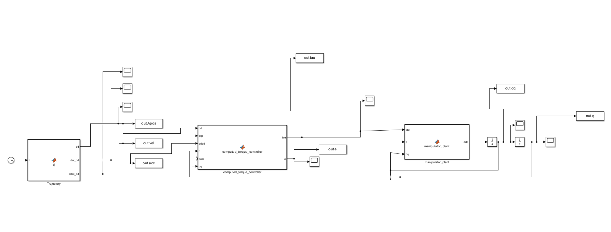
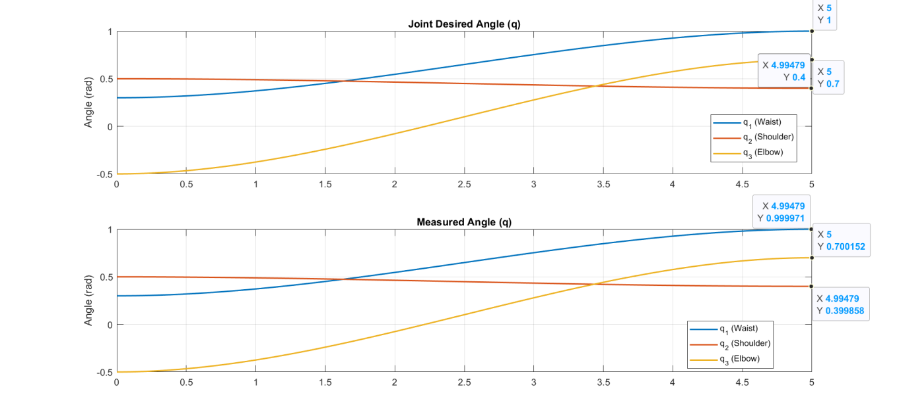
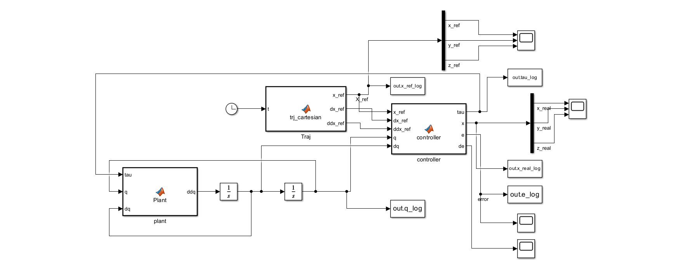
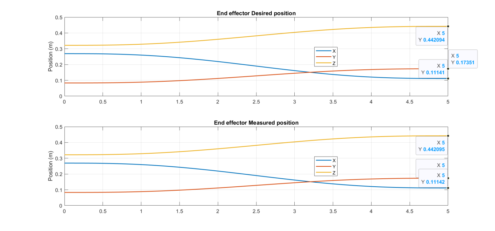
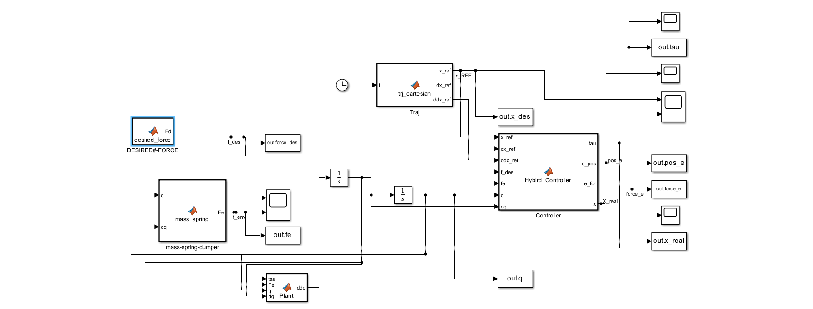
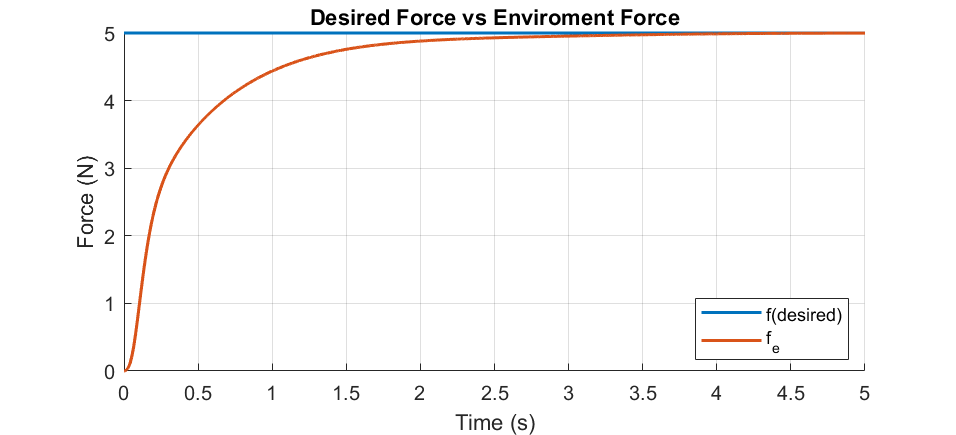
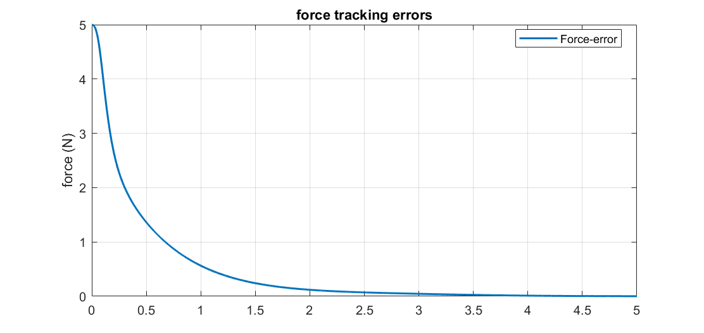

# 3-DOF Spherical Articulated Manipulator | Modeling and Control

**MATLAB & Simulink · Robot Kinematics · Nonlinear Dynamics · Computed Torque Control · Cartesian Control · Hybrid Position/Force Control**

> **Project:** Academic modeling and simulation (no physical robot experiments)  
> **Authors:** Mustafa Mohamed Ahmed Deri and İrfan Gereken  
> **Supervisor:** Assoc. Prof. Kamil Çetin  
> **Institution:** İzmir Kâtip Çelebi University | May 2026

## Project overview

This project investigates the modeling and control of a **three-degree-of-freedom (3-DOF) spherical articulated robot manipulator** using MATLAB/Simulink. The study develops a kinematic and nonlinear dynamic model, then examines three control approaches:

1. **Joint-space computed torque control** to track desired joint trajectories.
2. **Cartesian model-based control** to track desired end-effector positions.
3. **Hybrid position/force control** to regulate Cartesian position in the **X–Y plane** while controlling contact force along the **Z axis** against a simulated environment.

The project focuses on model-based control, trajectory tracking, joint torques, and interaction with a compliant environment. All figures shown below come from the original simulation report, not a physical robot test.

## System model

| Parameter | Symbol | Value |
|---|---|---:|
| Mass parameter | `m` | 2.5 kg |
| Base/vertical offset | `a1` | 0.25 m |
| Second link length | `a2` | 0.15 m |
| Third link length | `a3` | 0.15 m |
| Gravity | `g` | 9.81 m/s² |

### Forward kinematics

For joint angles `q = [q1, q2, q3]ᵀ`, the modeled end-effector position is

```text
r = a2*cos(q2) + a3*cos(q2 + q3)
x = cos(q1)*r
y = sin(q1)*r
z = a1 + a2*sin(q2) + a3*sin(q2 + q3)
```

The linear Jacobian `Jv(q)` relates joint velocity to end-effector velocity:

```text
p_dot = Jv(q) * q_dot
```

### Nonlinear dynamics

The manipulator is modeled using

```text
tau = M(q)*q_ddot + V(q,q_dot) + G(q) + F(q_dot)
```

where `M` is the inertia matrix, `V` represents velocity-dependent terms, `G` is gravity, and `F` represents friction. The simulation also considers external contact forces in the hybrid-control case.

For the derivations and modeling assumptions, see [Kinematics](docs/01_kinematics.md) and [Dynamics](docs/02_dynamics.md).

## Control strategies

| Strategy | Objective | Main idea |
|---|---|---|
| **Computed torque (joint space)** | Track joint-angle trajectories | Use model-based torque compensation and tracking feedback |
| **Cartesian model-based control** | Track end-effector `x`, `y`, `z` position | Use manipulator kinematics and dynamics in task-space control |
| **Hybrid position/force control** | Track `x`, `y` position and `z` contact force | Separate position-controlled and force-controlled directions |

The hybrid control strategy uses direction-selection matrices:

```text
S_position = diag([1, 1, 0])
S_force    = diag([0, 0, 1])
```

Read more in [Control Strategies](docs/03_control_strategies.md).

## Simulation results

### 1. Joint-space computed torque control



*Simulink architecture for the joint-space computed torque control simulation.*



*Desired and simulated joint-angle responses for the three manipulator joints.*

### 2. Cartesian model-based control



*Simulink architecture for the Cartesian control simulation.*



*Desired and simulated end-effector positions along X, Y and Z.*

### 3. Hybrid position/force control



*Hybrid control simulation with a modeled contact environment.*



**Contact force response:** The blue curve is the **desired force** `Fd = 5 N`; the orange curve is the **environment contact force** `Fe`. The simulated contact force rises from zero and approaches the 5 N reference within the displayed 5-second interval. **`Fe` is not the tracking error.**



**Force-tracking error:** This separate plot shows `eF = Fd − Fe`, which decreases from approximately 5 N toward zero over the displayed interval. The graphs support a qualitative convergence observation; no exact steady-state error or settling time is claimed without checking the logged simulation data.

**[View all 14 simulation figures and technical explanations →](Results/RESULTS.md)**

## Repository organization

```text
3dof-robot-manipulator-control/
├── README.md
├── docs/
│   ├── 01_kinematics.md
│   ├── 02_dynamics.md
│   ├── 03_control_strategies.md
│   ├── 04_results_and_limitations.md
│   ├── 05_reproduction_guide.md
│   └── 06_source_review_notes.md
└── Results/
    ├── RESULTS.md
    └── figures/
        ├── joint_space_*.png
        ├── cartesian_*.png
        └── hybrid_*.png
```

> **Source-code status:** MATLAB `.m` scripts and Simulink `.slx` models are being reviewed separately and are intended to be added in a later publication stage. This repository currently documents the modeling approach and original reported simulation results; it is not yet a fully reproducible code release.

## Limitations

- All reported results are from **MATLAB/Simulink simulations**; no physical manipulator experiments are claimed.
- Figures were extracted from the academic report and have not been regenerated from raw logs.
- Some written force-error statements in the original report are inconsistent with the displayed convergence plots. This repository distinguishes **environment force `Fe`** from **tracking error `eF`** and avoids asserting an unverified numerical steady-state value.
- Controller performance metrics, software versions, and reproduction steps should be verified when the original models are published.

See [Results and Limitations](docs/04_results_and_limitations.md) and [Reproduction Guide](docs/05_reproduction_guide.md).

## Credits

**Mustafa Mohamed Ahmed Deri** and **İrfan Gereken** developed this project as collaborative academic work under the supervision of **Assoc. Prof. Kamil Çetin** at İzmir Kâtip Çelebi University. Individual contributions are not assigned here because the source report does not separate them.

**GitHub:** [Mustiiiio](https://github.com/Mustiiiio)
