# Simulation Results | 3-DOF Spherical Articulated Manipulator

[← Back to project overview](../README.md)

This gallery presents **14 figures from the original academic project report**. The figures show MATLAB/Simulink simulations, **not physical robot measurements**. The captions distinguish measured/simulated signals from reference commands and error signals. Numerical performance metrics have not been recomputed from raw simulation logs.

## 1. Joint-space computed torque control

The objective is to follow prescribed joint trajectories using model-based compensation and tracking feedback.

### Controller architecture

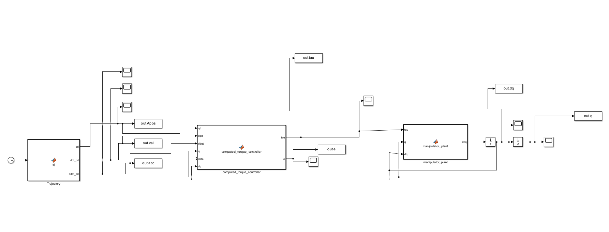

*Simulink model of the joint-space computed torque controller and manipulator plant.*

### Desired versus simulated joint angles

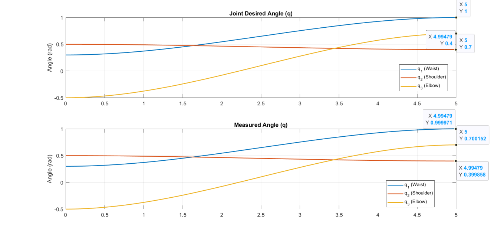

*Reference and simulated angular trajectories for the waist, shoulder, and elbow joints. The plot permits a visual comparison of tracking performance.*

### Joint tracking error

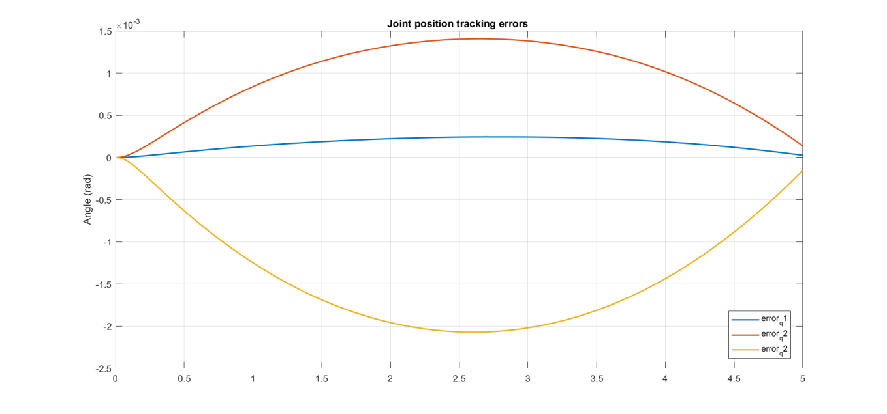

*Joint position error for the three joints. This is an error plot, distinct from the joint-angle response above.*

### Joint torques

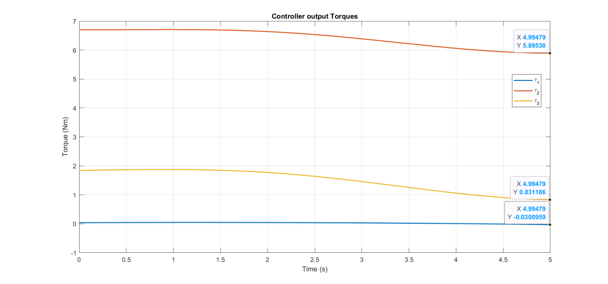

*Simulated actuator torque commands generated by the joint-space controller.*

## 2. Cartesian model-based control

This strategy controls the end-effector position in Cartesian coordinates, using the kinematic Jacobian and a model-based controller.

### Controller architecture

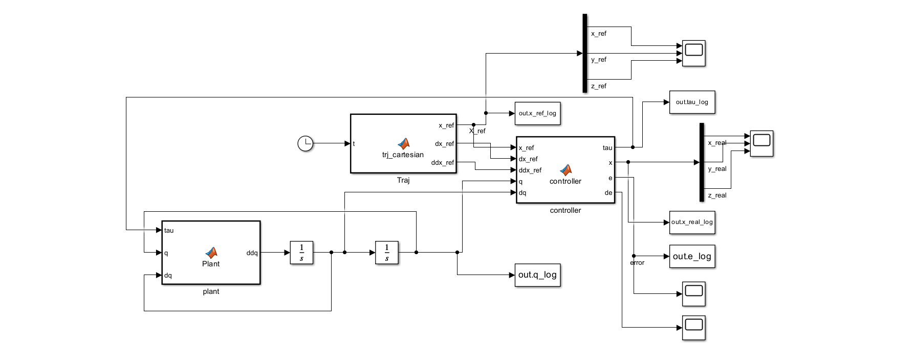

*Simulink model used for Cartesian tracking.*

### Desired versus simulated end-effector position

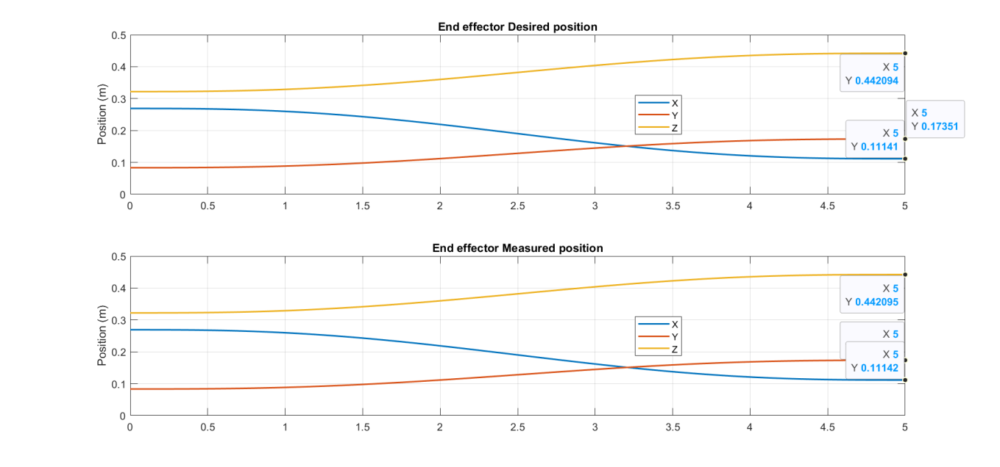

*Reference and simulated X, Y and Z end-effector positions, expressed in meters.*

### Cartesian position tracking error

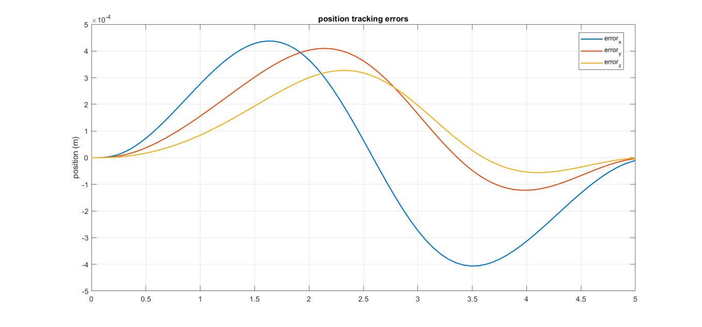

*End-effector position tracking errors along the three Cartesian axes.*

### Joint torques

*Simulated joint torque commands during Cartesian position control.*

## 3. Hybrid position/force control

The hybrid strategy separates **position regulation in X and Y** from **contact-force regulation along Z**. The simulated end effector interacts with a modeled compliant environment.

### Hybrid controller and contact environment

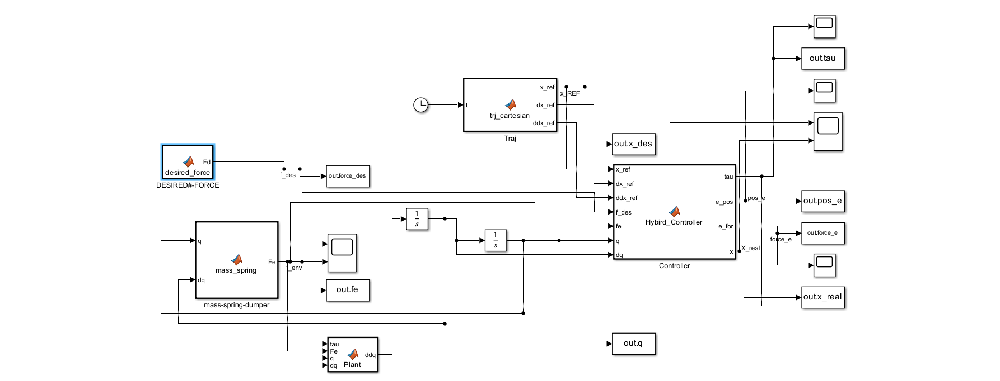

*Hybrid position/force control architecture, including the simulated environment contact model.*

### Cartesian position response

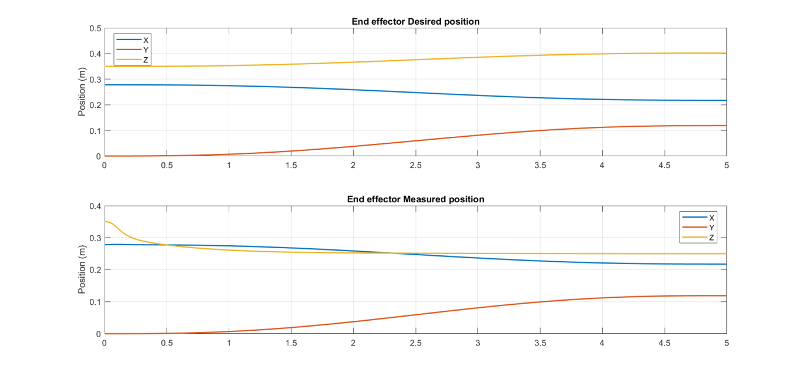

*Desired and simulated end-effector positions. The Z direction is force-controlled during contact; it should not be interpreted as an ordinary free-space position-tracking objective.*

### Cartesian position error

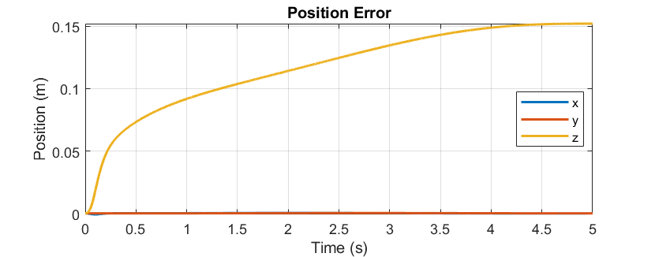

*Position-error signals shown in the original report. The X and Y errors relate to the controlled position axes; the Z signal must be interpreted in the context of contact-force regulation.*

### Desired force versus environment contact force

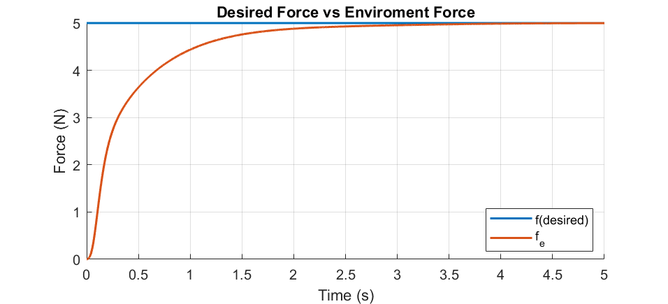

*Blue: desired contact force `Fd = 5 N`. Orange: simulated environment contact force `Fe`.*

**Interpretation:** `Fe` is the **environment reaction/contact force**, **not** the force-tracking error. It rises from zero and approaches the 5 N desired force over the displayed 0–5 s interval, without visible overshoot.

### Force-tracking error

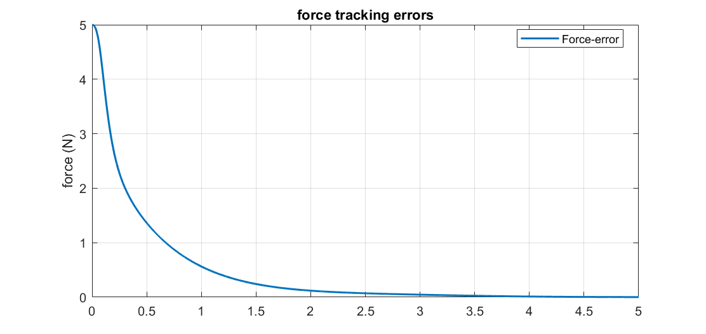

*Separate force-tracking error signal: `eF = Fd − Fe`.*

The displayed error starts at approximately 5 N and decreases toward zero. This plot is consistent with the environment-force response above: as `Fe` approaches `Fd`, their difference decreases. The report contains an inconsistent written description of an approximately 0.5 N offset; a definitive numerical steady-state error should therefore be reported only after verifying the original logged simulation output.

### Joint torques

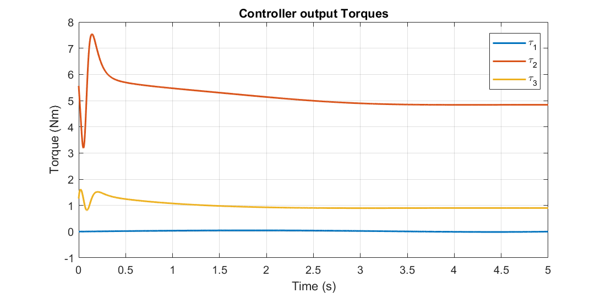

*Simulated actuator torque commands during the hybrid position/force-control task.*

## Signal definitions

| Signal | Meaning | Unit |
|---|---|---|
| `Fd` | Desired contact force | N |
| `Fe` | Environment contact/reaction force | N |
| `eF = Fd − Fe` | Force-tracking error | N |
| `x_d`, `y_d`, `z_d` | Desired Cartesian positions | m |
| `x`, `y`, `z` | Simulated Cartesian positions | m |
| `tau` | Joint actuator torques | N·m |

## Reproducibility notes

- The figures are extracted from the original report, not regenerated or numerically reanalyzed.
- MATLAB/Simulink source files will be added only after a separate code review.
- No experimental robot-hardware validation is claimed.
- Precise tracking metrics should be calculated from original simulation logs and associated with their model parameters and test conditions.

[← Return to README](../README.md)
